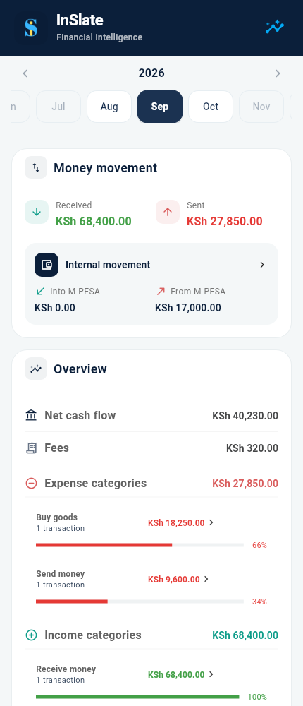
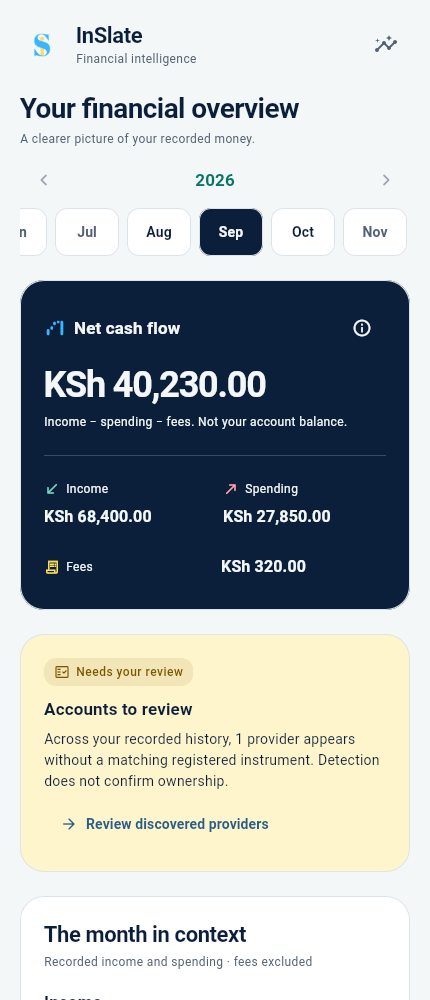

# InSlate Experience 2.0 — Foundation and Home

> **Dashboard restoration:** Following review, Dashboard has been returned to its previous interface: navy branding header, pinned month selector, Money movement and Overview cards, original card order and paired capital-movement rows. A Dashboard-only compatibility theme preserves the previous typography and controls without rolling back the shared design foundation or changing other screens. The original current-month recent-activity behavior is restored. Large-text overflow fixes remain. The restoration passes 61 focused widget tests, scoped analysis and formatting checks. Financial calculations, schema, data and mapping behavior are unchanged.
>
> The v2 design tokens, shared components, navigation styling and standalone attention/comparison components remain available. The Home redesign descriptions and captures below document the earlier proposal, not the currently restored Dashboard. See the [restored Dashboard capture](v2-captures/restored/home.png).


See [navigation and device-safe layout](Navigation_and_Device_Insets.md) for the app-wide phone-navigation, tab-bar and keyboard inset policy.


This milestone starts from `v2` commit `7e212c6`. It changes presentation and read-only composition. The original blue/yellow logo is unchanged. Schema v11, persisted data, effective subtype interpretation, mappings, category policy, repositories and financial calculations are unchanged. No PDF ingestion, SMS permission or account-management work is included.

## Home's information hierarchy

Before, received/sent totals led the screen, and net cash flow was a small row in a second card. Savings and investments shared a panel; historical months had no recent-record preview.

Home now leads with the selected month and a navy **net cash flow** card. Income and ordinary spending sit side by side, with all recorded fees on a separate line. The equation and “not your account balance” explanation are visible beside the amount. The information button explains exclusions; Fees opens a shared bottom sheet and supporting activity.

Actual account-review tasks appear next. These use the existing detected-provider and registered-instrument providers across recorded history. A prompt appears only when a provider has no matching registration. Counts describe providers, never owned accounts; recognition does not establish ownership. The action opens the existing review screen without changing registration or mapping behavior. Unavailable review data has its own retry.

A comparison card uses the existing Insights aggregation and preceding-calendar-month policy. It compares recorded income and expense principal. Both months must contain records; absent history is never a fabricated zero baseline. Negative principal values keep their signs and omit nonnegative ratio bars. Both month values open Activity with the corresponding snapshot period and scope. Copy explicitly warns about incomplete current months and coverage.

Investments, savings and loans have distinct cards. Purchases/redemptions and deposits/withdrawals retain their exact breakdown actions. Loan principal stays separate from ordinary income/spending. Transfers explain that savings and investment movements overlap these totals, so they must not be added together. Purpose-unspecified principal retains its existing independent query and drill-down.

Recent activity now shows the latest records within **any selected month**, followed by budgets and supporting transaction-type/party breakdowns. All drill-down filters remain snapshots of the displayed period. Type previews retain the existing grouping behavior: the legacy “Expense/Income categories” captions refer to transaction types; actual purpose-category insights remain in Insights.

Initial loading and failures use shared state components with a safe retry. An empty month has a distinct, explanatory empty state instead of a page of zero metrics. A month switch masks every old-period amount, disables old-period actions and hides dependent previews until the new period arrives. Same-period refreshes retain their mounted content.

## Tokens

`inslate/lib/core/design/design_tokens.dart` owns semantic palettes, spacing, radii, elevation and motion. `AppTheme.light()` and `AppTheme.dark()` install the palette as a `ThemeExtension`. Migrated widgets resolve `SlateColors.of(context)`; legacy `AppTheme` aliases remain for later screen milestones.

| Role | Light | Dark |
| --- | --- | --- |
| Canvas | `#F4F7F8` | `#091522` |
| Surface | `#FFFFFF` | `#122438` |
| Inset surface | `#EDF2F5` | `#1C3148` |
| Primary text | `#0B1F3A` | `#F4F7F8` |
| Secondary text | `#526274` | `#B1C0CF` |
| Boundary | `#DCE4EB` | `#344B62` |
| Income | `#087568` | `#70D9C2` |
| Spending | `#B33D45` | `#FFA4AA` |
| Other movement | `#285E88` | `#8BCEFF` |
| Attention text / surface | `#795600` / `#FFF5CC` | `#FFDE59` / `#342C15` |
| Cash-flow surface / text | `#0B1F3A` / `#F4F7F8` | `#16324E` / `#F4F7F8` |

Brand cyan `#38B6FF` and yellow `#FFDE59` remain restrained accents on navy. Brand teal `#0F9D8A` remains a compatibility token; its darker semantic income variant gives readable small text on white. Tests verify WCAG AA 4.5:1 contrast for financial/body text on its designated surface. Labels, arrows and signed amounts carry meaning alongside color. Savings contributions and loan principal use neutral movement presentation, not income/expense sentiment.

Typography uses Flutter's existing Roboto family with no downloaded app font or new package: display 36, headline 28, title 22/17, body 14/12 and label 14 logical pixels. Display/title tracking is restrained; body line height is 1.5. Financial figures use tabular numbers and the existing exact `formatMoney` presentation, keeping KSh, signs, two decimals and grouping. Budget minor-unit formatting remains unchanged.

Spacing follows 4/8/12/16/24/32/40 px, with a 20 px page inset. Controls use 12 px corners, cards 24 px and sheets/dialogs 28 px. Content cards have zero elevation and a quiet boundary; overlays use elevation 6. No gradients or new dependencies are introduced.

## Reusable components and usage

| Component / API | Purpose |
| --- | --- |
| `SlateCard` | Shared surface, boundary, radius and padding; optional semantic background |
| `SlateAmount` | Consistent KSh formatting, tabular figures, full precision and pending placeholder |
| `SlateSectionHeading` | Wrapping title/subtitle with optional action |
| `SlateStatus` / `SlateTone` | Icon plus labeled financial/attention status |
| `SlateChoice` | Keyboard-accessible selected chip/tab control with a 48 px target |
| `SlateState` | Loading, empty and retryable-error presentation; announcements use a live region |
| `showSlateSheet` | Safe, scrollable sheet with keyboard insets and reduced-motion policy |
| `AppDialog` / `showSlateDialog` | Shared informational/form dialogs with semantic surfaces |
| `showSlateConfirmation` | Shared confirmation; dismissal/cancel returns false; callers own mutations |
| Material buttons, chips and tabs | Filled, outlined, text and elevated buttons, `Chip` and `TabBar` are themed centrally in `AppTheme` |
| `TransactionRow` / `FinancialGroupRow` | Existing semantics and filters, now with palette-aware presentation |

Use standard Material buttons rather than screen-specific button decoration. Destructive confirmations must explain the action and consequence and keep cancellation available. `showSlateConfirmation` does not perform any financial action.

### Motion and accessibility

New sheets and dialogs use 180 ms standard transitions; `SlateMotion.duration` resolves to zero for disabled animations or accessible navigation. No looping shimmer, chart animation or decorative counting is introduced. Preserve platform route navigation and focus behavior. Future animations must use this policy, never animate the financial value itself, and never delay interaction.

Home is centered within 760 px. Metric pairs reflow into a single column below 300 px of card content or with large text. Text scaling is not clamped; critical amounts wrap rather than being truncated or scaled down. Month controls grow with text size and retain availability rules. The header scrolls with content instead of reserving a fixed-height pinned area. Sheets and dialogs scroll and respect safe areas/keyboard insets. Tooltips identify icon actions, month choices announce selection and financial meaning is expressed in text.

The application keeps its existing light-theme selection policy. `AppTheme.dark()` and all migrated Home components are validated in dark-theme widget tests and captures. A global theme switch is deferred until the remaining screens' hard-coded surfaces and dialogs are migrated; this milestone does not promise whole-app dark mode.

## Review captures

These are Flutter widget-test renders at 430 × 1000 using SDK Roboto/Material fonts, the original logo and explicitly synthetic persisted records. They show standalone Dashboard content rather than a physical device or the AppShell navigation bar. The same selected-month dataset is used before and after: income KSh 68,400.00, ordinary spending KSh 27,850.00, fees KSh 320.00 and net cash flow KSh 40,230.00. August records support the comparison; the review prompt comes from the synthetic M-Shwari deposit.

| Before | After |
| --- | --- |
|  |  |

Additional renders: [movements](v2-captures/after/movements.png), [dark Home](v2-captures/dark/home.png), [empty month](v2-captures/empty/home.png), [loading](v2-captures/loading/home.png), [error](v2-captures/error/home.png).

To regenerate an after capture from `inslate/` with a compatible Flutter SDK (validated with 3.41.3):

```bash
SLATE_FONT_DIR="$FLUTTER_ROOT/bin/cache/artifacts/material_fonts" \
SLATE_CAPTURE_DIR="../Documentations/v2-captures/after" \
SLATE_CAPTURE_DETAILS=true flutter test --no-pub test/screens/home_v2_capture_test.dart
```

Set `SLATE_CAPTURE_DARK=true` for a dark render. Set `SLATE_CAPTURE_STATE=empty`, `loading` or `error` and select a different output directory for state captures. Before captures use the original v2 presentation with the same harness and records.

## Validation and remaining work

Focused validation covers Home's existing transaction/party/capital drill-downs, snapshot periods, query retry, refresh preservation, stale-period masking, budgets, recent activity, lazy tab navigation and SMS reconciliation behavior; plus new dark-mode, negative cash-flow, real review-query, comparison, 200% text, responsive layout, contrast and reduced-motion confirmation tests.

```bash
flutter test --no-pub test/screens/dashboard_screen_test.dart \
  test/screens/dashboard_integration_test.dart test/screens/home_v2_design_test.dart \
  test/screens/app_shell_test.dart test/screens/unspecified_movements_card_test.dart \
  test/screens/home_v2_capture_test.dart
flutter analyze --no-pub lib test/screens/dashboard_screen_test.dart \
  test/screens/dashboard_integration_test.dart test/screens/home_v2_design_test.dart \
  test/screens/home_v2_capture_test.dart test/screens/app_shell_test.dart \
  test/screens/unspecified_movements_card_test.dart
```

The focused run passes **62 tests**. Application code and these focused test files analyze cleanly. Changed Dart files pass formatting checks and the diff passes whitespace validation. A repository-wide analyzer run remains blocked by the pre-existing ignored `test/fixtures/mshwari_loan_messages.dart` import (and its undefined symbols) in parser, balance-extractor and ingestion tests. The full suite was not run. Android device behavior is not established by these widget captures.

Follow-up milestones should migrate Accounts/instrument screens' white surfaces, compact headers, review grouping and bespoke sheets; Activity's search/filter surfaces and details; Insights' hard-coded chart/tooltip colors, date-picker styles and chart text scaling. Other form screens, profile, startup and permission flows retain legacy styling. Shared token/theme improvements may affect their Material controls, but those screens are intentionally not redesigned here. Purpose-category captions should be made consistent when Activity and Insights are redesigned; the underlying meaning must remain intact. Global dark-theme selection should wait for those migrations. Do not infer balances, account ownership, debt outstanding, investment returns or history completeness from Home's movement totals.
